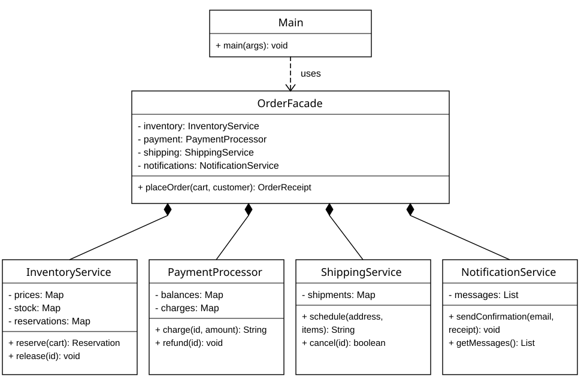

# SDP Assignment 4

An online order processing example of the **Facade** structural design pattern.
Written in Java 17 without external libraries.

The client calls `OrderFacade.placeOrder(cart, customer)`. The facade reserves
stock, charges an account, schedules a shipment, and queues a confirmation.
If a later step fails, it cancels the shipment, refunds the charge, and releases
the reserved stock in reverse order.

## Run

Install JDK 17 and run these commands from the project folder:

```text
javac --release 17 -Xlint:all -d out src/shop/*.java
java -cp out shop.Main
```

In IntelliJ IDEA, open the folder, select JDK 17, mark `src` as Sources Root,
and run `shop.Main`.

The demo shows Bob's declined payment, Alice's successful purchase of the same
stock after rollback, and a final rejection because the keyboards are sold out.

## Test

```text
javac --release 17 -Xlint:all -d out src/shop/*.java test/shop/*.java
java -cp out shop.OrderFacadeTest
```

Expected result: `All 15 tests passed.` No test framework or assertion flag is needed.
The tests also call subsystem services directly to verify their independent use.
The application client in `Main` uses only the facade and business data.

## Structure

```text
src/shop/                 Application code and business records
test/shop/                Checkout, rollback, and subsystem tests
docs/Report.pdf           Assignment report with UML and Clean Code examples
docs/class-diagram.svg    Readable UML diagram
docs/class-diagram.mmd    Editable Mermaid diagram source
docs/verification.txt     Captured demo and test results
```

## Sample shop

| Product | Unit price in USD | Initial stock |
| --- | ---: | ---: |
| KEYBOARD | 50.00 | 2 |
| MOUSE | 25.00 | 5 |

Alice's account ID is `alice`, with a balance of 100.00 USD. Bob's account ID
is `bob`, with 10.00 USD. Customer email and delivery address are supplied
when placing an order. Each new `OrderFacade` starts a separate sample shop.

## Design

`OrderFacade` is the Facade, `Main` is the Client, and `InventoryService`,
`PaymentProcessor`, `ShippingService`, and `NotificationService` are the
subsystem. `Customer` and `OrderReceipt` are simple data records.

The subsystem services are public and have no references to `OrderFacade`.
Advanced callers can use them directly. The facade has one business operation;
it does not expose service objects or require the client to manage rollback.



The program is a single-threaded, in-memory simulation. It does not contact
a bank, carrier, or email server. Confirmations are stored in a local outbox.
Data resets on restart; email validation is deliberately basic. IDs are local
to each instance. The example omits persistence, concurrent checkout, taxes,
discounts, and user-initiated cancellation to keep the assignment focused.
